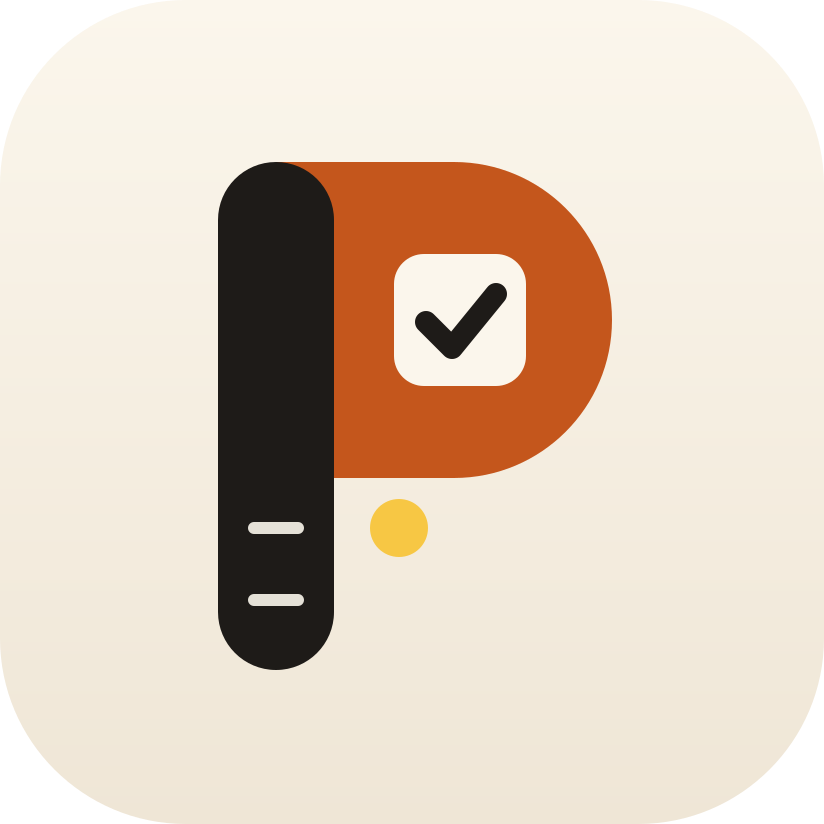
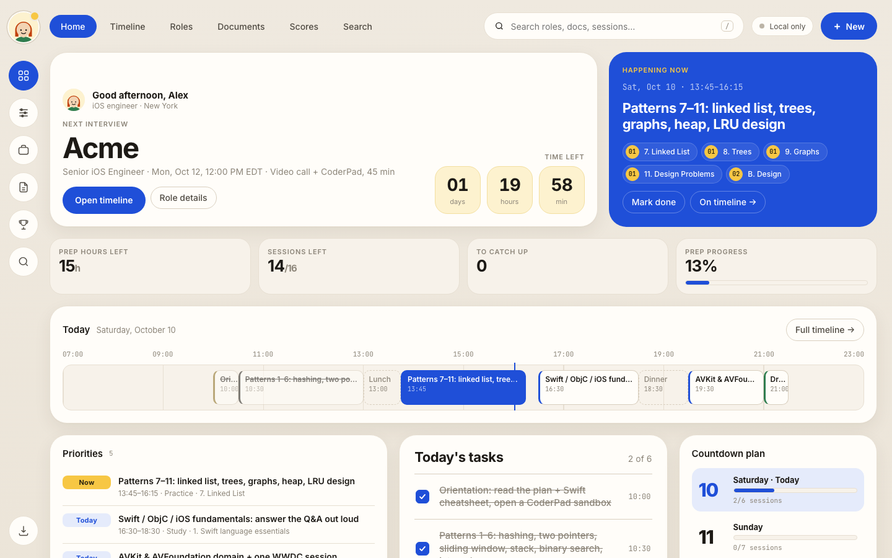
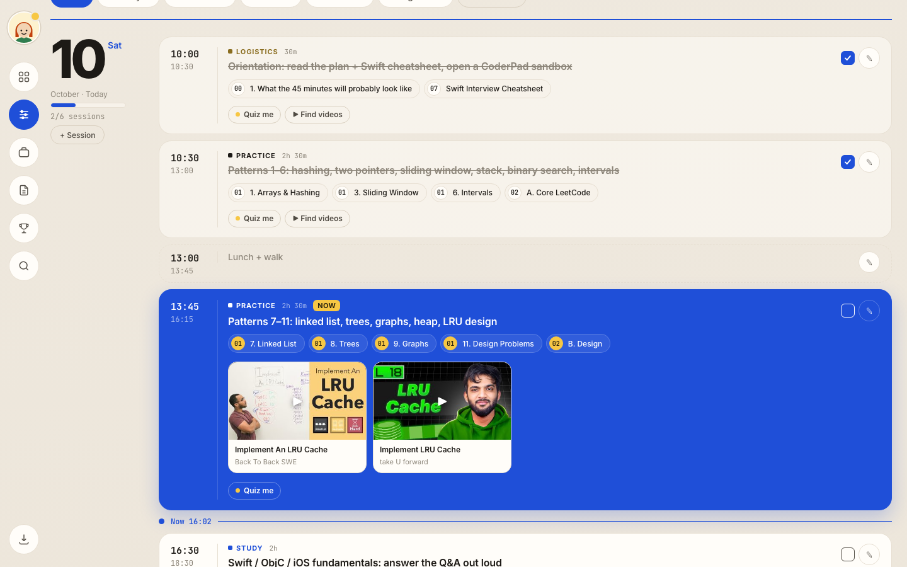
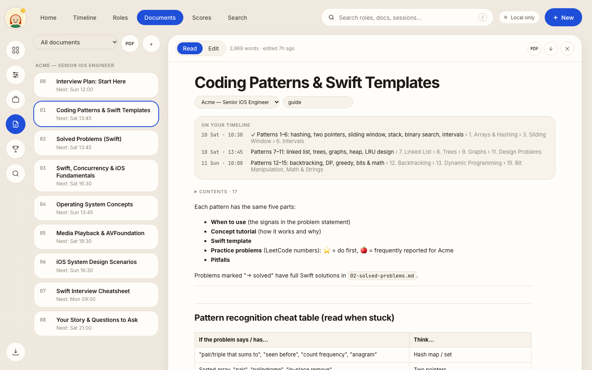
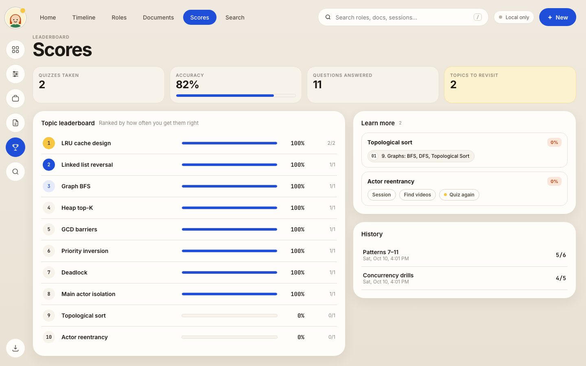
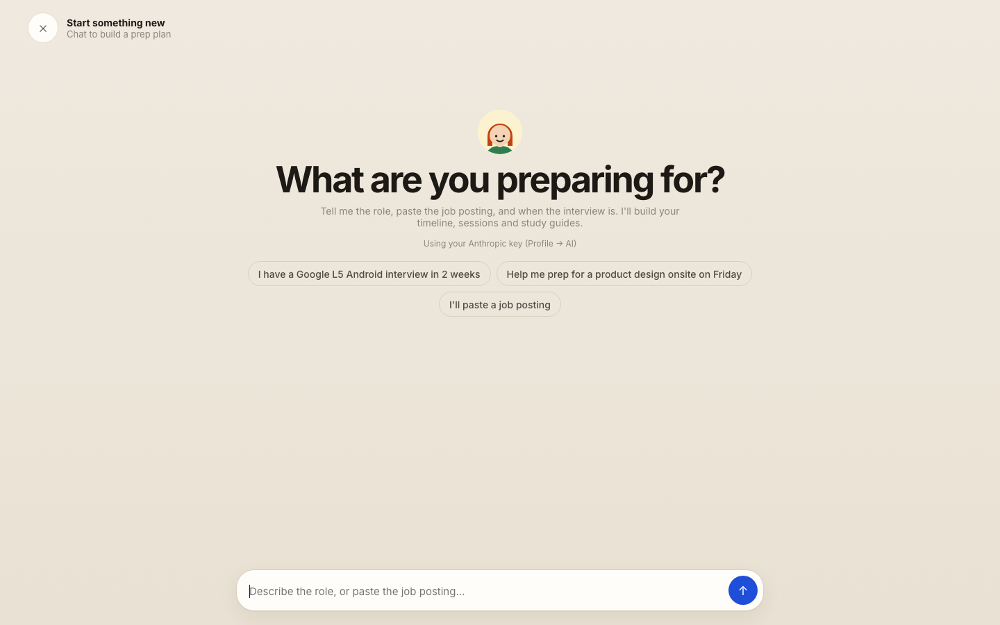
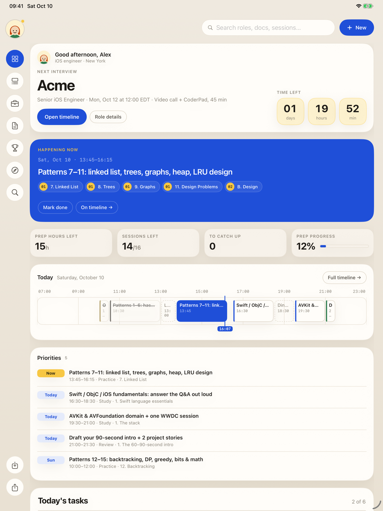
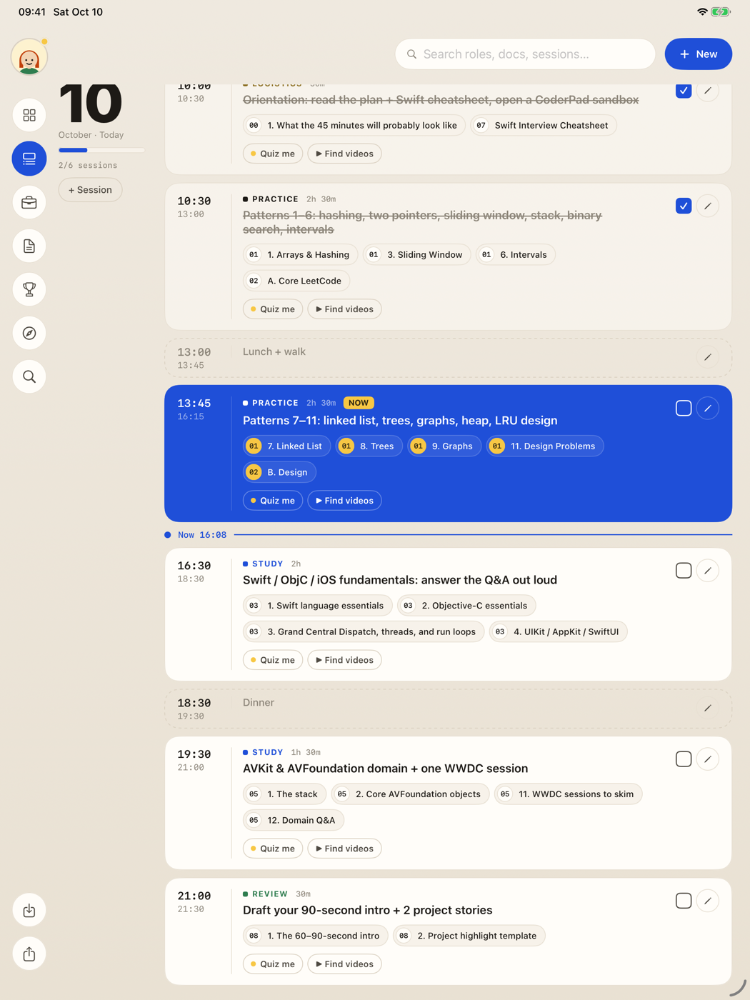
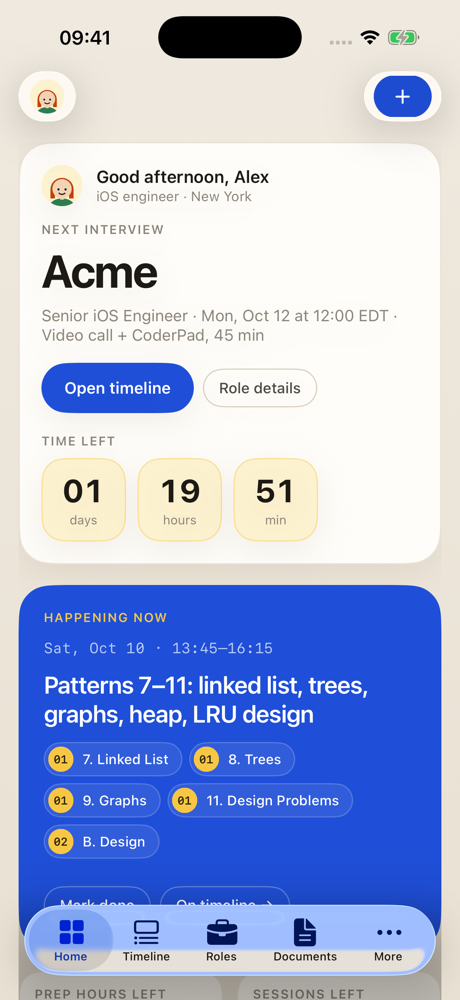

<p align="center">
  
</p>

<h1 align="center">PrepBoard</h1>

<p align="center">
  <b>Plan, study and practice for interviews, one session at a time.</b><br>
  A calm, timeline-first prep workspace for the web, Mac, iPad and iPhone.
</p>

<p align="center">
  <a href="https://prepboard.shivvyas.com"><b>Open the web app</b></a> ·
  <a href="https://github.com/shivvyas2/Prepboard/releases/latest">Download for Mac</a> ·
  <a href="#ipad--iphone">iPad &amp; iPhone</a>
</p>

---



## What it does

- **Start something new by chatting.** Tell the planner the role, paste the job posting and say when the interview is. It asks a couple of questions, then builds the role, a time-blocked timeline and tailored study guides.
- **Home shows everything at a glance:** the countdown to your interview, what's happening now, today's hour strip, priorities, a checklist and the day-by-day plan.
- **Timeline:** big day numerals, time-blocked sessions (study, practice, mock, review), and a live "now" line. Every session links to the exact guide section to study.
- **Documents:** Markdown guides with a reading view, plus PDFs (job postings, résumés) rendered inline. Each doc shows when it's on your timeline.
- **Quizzes and a Scores leaderboard:** "Quiz me" writes multiple-choice questions from a session's material, shows the correct answer and an explanation each time, and tracks mastery by topic, with a *Learn more* list for weak spots.
- **YouTube videos:** "Find videos" pulls 3–4 strong explainers for a session and plays them in the app.
- **Browse:** an in-app browser (native apps) with "Save to notes" for research.
- **Accounts and sync:** sign in once and your roles, sessions, docs, PDFs, quiz history and profile sync across every device.
- **Your choice of AI:** use your own Anthropic API key, or your Claude account through Claude Code.

| Timeline | Documents | Scores |
|---|---|---|
|  |  |  |

| Start something new |
|---|
|  |

## iPad & iPhone

Native SwiftUI, iPad-first: it uses the full display in both orientations, with a side rail on iPad and a tab bar on iPhone.

| iPad | iPad Timeline | iPhone |
|---|---|---|
|  |  |  |

**Use your Claude account on iPhone and iPad (optional).** On the Mac, open PrepBoard → Profile and check *Let my iPhone and iPad use Claude Code*. It shows the Mac's address and a pairing code. On the iPhone or iPad, go to Profile → *Claude Code on my Mac* and enter both. The planner, study guides, quizzes and videos then run on your Mac's Claude Code while PrepBoard is open there, over the same Wi-Fi or anywhere with [Tailscale](https://tailscale.com). When the Mac can't be reached, the app uses your Anthropic key.

Distribution is through TestFlight; see [Releases](https://github.com/shivvyas2/Prepboard/releases) for the current status.

## Mac

The same SwiftUI app runs natively on macOS, with keyboard shortcuts, the Claude Code side panel (⌘J) and the in-app browser. Download the DMG from [Releases](https://github.com/shivvyas2/Prepboard/releases/latest).

> The Mac build isn't notarized yet. On first launch, right-click **PrepBoard.app → Open**, then confirm.

---

## How it's built

```
web/        Web app: vanilla HTML/CSS/JS, no build step (Vercel static hosting)
native/     SwiftUI app for macOS, iPadOS and iOS (SwiftData + supabase-swift), generated with XcodeGen
supabase/   Postgres migrations (Row Level Security) + the `prep-chat` Edge Function
bridge/     Optional local helper so the web app can use your Claude Code
brand/      App icon sources
```

- **Data:** Supabase Postgres. Every table is owner-only through Row Level Security. PDFs live in a private storage bucket, with one folder per user.
- **AI:** the `prep-chat` Edge Function (planner, study guides, quizzes, YouTube search) uses the Claude API with tool use and structured outputs. It requires a signed-in user.
- **Your API key:** keys are validated, encrypted with AES-GCM on the server and stored in a table that clients can't read. The app only ever shows the last four characters.
- **Claude Code:** the Mac app runs `claude -p` with read-only and web tools. Sharing it with your iPhone/iPad is off by default; when on, the Mac app listens on port 8788 and requires a 16-character pairing code (kept in the Keychain on both devices), refuses browser requests, and locks out an address after 10 wrong codes. *New code* unpairs every device. The web app can use the same thing through `bridge/claude-bridge.mjs`, which listens on 127.0.0.1 only and accepts requests only from the Prepboard web origins.

## Run it yourself

**Web**
```bash
cd web && python3 -m http.server 8765   # then open http://localhost:8765
```
Put your Supabase project URL and **anon** key in `web/config.js`. Leave them empty to run locally without accounts.

**Native (macOS / iPadOS / iOS)**
```bash
brew install xcodegen
cd native && xcodegen generate && open Prepboard.xcodeproj
```
Set the same URL and anon key in `native/Prepboard/Model/Cloud.swift` (`CloudConfig`), then choose your team under Signing & Capabilities.

**Backend (Supabase)**
```bash
supabase link --project-ref <your-ref>
supabase db push                                  # tables, RLS, storage bucket
supabase secrets set PB_KEY_SECRET=$(openssl rand -base64 48)   # encrypts users' saved API keys
supabase secrets set ANTHROPIC_API_KEY=sk-ant-…   # optional fallback for users without their own key
supabase functions deploy prep-chat
```

**Use your Claude account in the web app (optional, Mac)**
```bash
node bridge/claude-bridge.mjs
```

### Developer launch flags (native)
`-PrepboardLocalOnly YES` (no accounts) · `-PrepboardSection timeline|documents|scores|browse` · `-PrepboardOpenURL https://…` · `-PrepboardImport /path/export.json`

## Privacy & security

- No secrets are committed. The Supabase **anon** key in the config files is public by design; Row Level Security protects every row.
- Service-role keys, the key-encryption secret and API keys live only in Supabase secrets.
- New accounts start empty; nothing is shared between accounts.

## License

© 2026 Shiv Vyas. All rights reserved.
